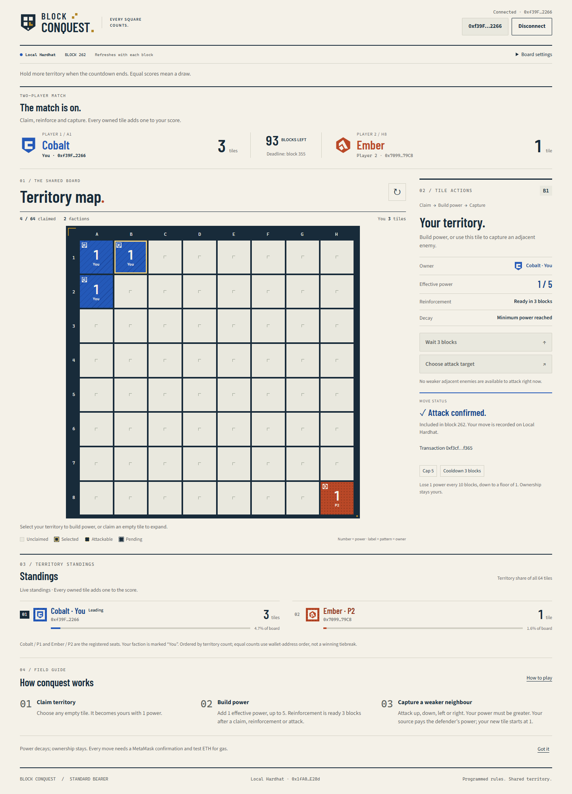
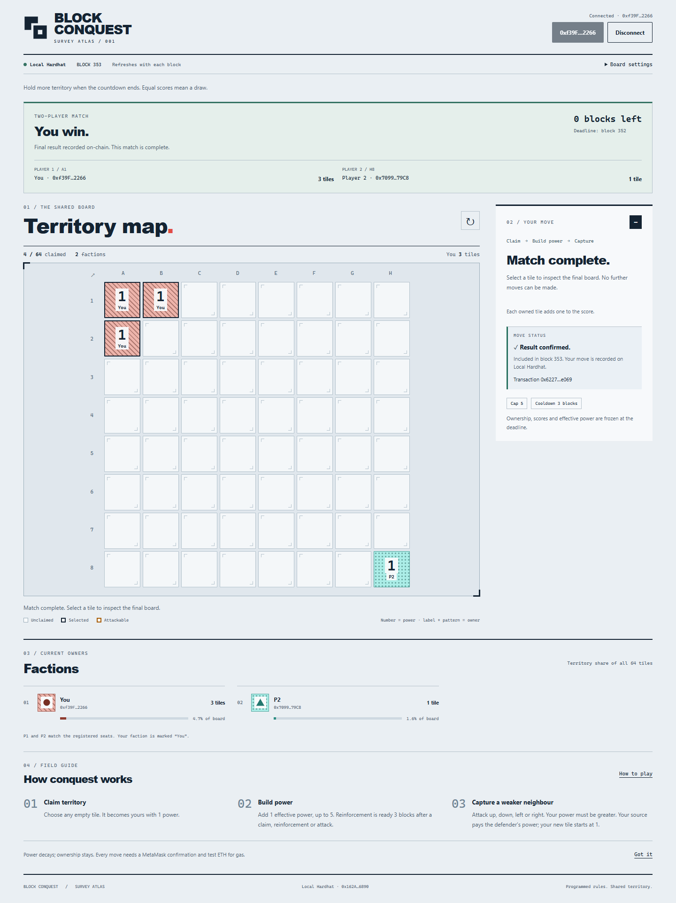

# Block Conquest — two-player matches

A university DApp built with Solidity, ethers.js, MetaMask and Vite. Two players compete on one shared 8×8 board: claim territory, build power and capture weaker neighbours. **Hold more tiles when the block countdown ends to win. Equal scores mean a draw.**

## Version and network

The two-player contract is **`BlockConquestMatch`**, deployed on Sepolia and tested through a complete two-account match. Player 2 won **3–0**; the finalization receipt, game events and current scores were checked through Sepolia RPC. See [match deployment evidence](docs/MATCH_DEPLOYMENT.md). The earlier open-board contract remains a separate deployment.

| Version | Network | Address / status |
| --- | --- | --- |
| Two-player match | Local Hardhat (`31337`) | Run `npm run deploy:local`; use the printed address |
| Two-player match | Ethereum Sepolia (`11155111`) | [`0x98f9726a04Fc43b6145A270f61c9a97243650A33`](https://sepolia.etherscan.io/address/0x98f9726a04Fc43b6145A270f61c9a97243650A33) |
| Earlier open board | Ethereum Sepolia (`11155111`) | [`0x4D8ebB57f5140fD302F7b1f4Ff57EF23ff1c3Cb3`](https://sepolia.etherscan.io/address/0x4D8ebB57f5140fD302F7b1f4Ff57EF23ff1c3Cb3) — select **Open board (earlier version)** |

The published match above is **complete**. Load it to inspect the final board and recorded result. To play a fresh match, deploy another instance using the steps below or use the local deployment command.

The completed open-board version is preserved at Git tag `v3-survey-atlas-open-board`. Its [Sepolia deployment and transaction evidence](docs/DEPLOYMENT.md) and [real MetaMask screenshot](docs/screenshots/sepolia-survey-atlas.png) apply to that earlier contract, which has no match deadline. The match version is developed on `feature/two-player-match`.

## How a match works

1. **Join:** the first two distinct wallet addresses take the seats. The first waits; no tiles or clock are active yet. The second join starts the match and gives player 1 **A1** and player 2 **H8**, both at power 1.
2. **Expand:** claim any empty tile. It starts at power 1 and adds one point to your score.
3. **Reinforce:** add 1 to effective power, subject to the tile's cooldown and the power cap.
4. **Capture:** select your tile → **Choose attack target** → an adjacent enemy → **Confirm attack**. Your effective power must be strictly greater. Your source loses the defender's effective power; the captured tile starts at 1. Scores update with ownership.
5. **Finish:** moves must be included strictly before the deadline block. At the deadline, the higher territory score wins; equal scores draw. Ownership, scores and effective power freeze.
6. **Record the result:** anyone can click **Record final result** after the deadline. This transaction stores the winner (or a draw) on-chain. The match ends even if nobody submits this transaction immediately. The UI distinguishes the locked result from its recorded confirmation.

Default settings are **10 blocks per power loss**, **3 blocks reinforcement cooldown**, **power cap 5**, and **100 blocks per match**. All four values are constructor arguments and immutable. Duration must exceed cooldown and fit `uint64`. A block countdown is not a wall-clock timer.

Decay floors at power 1 and never removes ownership; empty tiles have power 0. Claims, reinforcement and attacks restart reinforcement cooldown; attacks update both affected tiles. Attacks have no separate cooldown. A player with no tiles can claim another empty tile during the match. If no tiles are empty, they cannot return, but the match still ends at its deadline. Each deployment contains one match; a rematch requires a new deployment.

## Features and technology

- Survey Atlas interface with owner patterns, player labels, effective power, a match scoreboard and territory-share leaderboard counted from `getGrid()`.
- Match lobby, join/start transaction, block countdown, spectator view, winner/draw screen and result-recording transaction.
- Attack estimates, cooldown/decay countdowns, transaction feedback, and refreshes on new blocks.
- Wallet connection and Disconnect, account/network changes, keyboard navigation, mobile action row and reduced-motion support.
- Solidity **0.8.28**, Hardhat **3.19.0**, ethers.js **6.17.0**, Vite **8.3.4**, plain HTML/CSS/JavaScript and Playwright.
- No tokens, NFTs, betting, prizes, randomness, admin takeover or upgrades. Moves require gas, not a tile purchase price.

## Install and run

Use Git, npm and Node.js **24 LTS** (Hardhat requires at least 22.13.0). Initial compilation needs internet access to download the compiler. Install the [MetaMask extension](https://metamask.io/) for manual wallet interaction.

```sh
git clone https://github.com/JishnuJMR/block-conquest.git
cd block-conquest
git switch feature/two-player-match
npm ci
npm test
npm run dev
```

The match branch must be published before a remote clone can check it out. In the current local checkout, start at `npm ci`. Open **http://127.0.0.1:5173**. If that port is occupied, use `npm run dev -- --port 5174` and open port 5174 instead.

**Windows PowerShell:** if script policy blocks `npm.ps1`, use `npm.cmd` in place of `npm`. No execution-policy change is needed.

For the Sepolia match, select **Ethereum Sepolia**, **Two-player match**, and `0x98f9726a04Fc43b6145A270f61c9a97243650A33` under **Board settings**. Click **Load board**, then **Connect wallet**. The first two distinct accounts may join; the second join starts the countdown. To use the earlier Sepolia open board instead, select **Open board (earlier version)** and its separate address from the table above.

For a local match, use two additional terminals:

```sh
# Terminal 1: leave the local chain running
npm run node:local
```

```sh
# Terminal 2: deploy a fresh match
npm run deploy:local
```

Choose **Local Hardhat** and **Two-player match** in Board settings and enter the printed address. Manual local play uses disposable Hardhat test accounts; see the [local wallet instructions](docs/FRONTEND.md#optional-local-chain-for-development). Do not import your Sepolia wallet secrets into project files. Local Hardhat normally mines on transactions; see [advancing the local match clock](docs/MATCH.md#local-block-clock) for testing the deadline.

Board settings persist in the browser. Optional public defaults are in `frontend/.env.example`: copy it to `frontend/.env.local`, enter the address, chain ID and board mode, then restart Vite. Saved browser settings take priority. **Never put private keys, seed phrases or private RPC credentials in frontend variables; `VITE_` values are public.**

## Deploy a new match to Sepolia with Remix

These are manual deployment instructions. No deployment script here sends transactions to Sepolia.

1. Open [Remix](https://remix.ethereum.org/) in the browser containing MetaMask. Create `contracts/BlockConquestMatch.sol` and paste the complete [match contract](contracts/BlockConquestMatch.sol).
2. Select Solidity compiler **0.8.28**, enable optimizer **200 runs**, and choose EVM target **cancun**. Compile.
3. In MetaMask, enable test networks and select **Ethereum Sepolia**. Use a test wallet funded with Sepolia test ETH.
4. In **Deploy & Run Transactions**, select **Browser Extension → MetaMask** (also called **Injected Provider – MetaMask**). Confirm network **Sepolia / 11155111**.
5. Select **BlockConquestMatch** and leave **Value = 0**. Constructor arguments, in order: `decayInterval_ = 10`, `reinforcementCooldown_ = 3`, `maxPower_ = 5`, `matchDuration_ = 100`.
6. Click **Deploy**, review the network and gas fee, and confirm in MetaMask. Save the new address and creation transaction hash. Source verification on Etherscan is optional.
7. Read `decayInterval()`, `reinforcementCooldown()`, `maxPower()` and `matchDuration()` to confirm **10, 3, 5, 100**. `phase()` should return **0** (Waiting).
8. In the frontend select **Ethereum Sepolia**, **Two-player match**, and the new address. Connect player 1 and click **Join match**.
9. Have player 2 load the same address and connect their distinct wallet. **Join & start match** begins the countdown immediately. Have both players ready before this step.
10. Play, then click **Record final result** when the countdown ends. Save the creation/result transaction links and take a real Sepolia screenshot for the submission.

Signing stays in MetaMask. No wallet-key export or Infura API key is required. `npm run deploy:rehearsal` uses an ephemeral local Hardhat chain only.

## Tests and build

```sh
npm test
npm run typecheck
npm run test:frontend
npm run test:ui
npm run build
```

The suite contains **90 contract tests**, **12 frontend logic tests** and **29 browser integration tests**. Contract coverage includes joining, permissions, exact deadline boundaries, either winner/draw, immutable final state, all original tile rules, long inactivity and attacks using both effective powers. Browser tests exercise full matches, spectators, rejection, late transactions, disconnect/reconnect and mobile reachability, alongside the open-board regressions.

All **131 tests**, typechecking, production build and development-server startup passed in a fresh local Git checkout on Windows. A live two-player MetaMask match also completed on Sepolia: both joins, claim, reinforcement, capture and finalization were observed, with the result independently checked.

Run `npm test` before typechecking to generate types. Browser tests need installed Chrome and free ports **8545/4173**. Set `PLAYWRIGHT_CHANNEL=msedge` to use installed Edge instead. Browser automation uses real local contracts and a test-only wallet adapter; it does not automate the MetaMask extension or submit public-network transactions. Validation details are in [docs/VALIDATION.md](docs/VALIDATION.md).

`npm run build` emits `frontend/dist/`; `npm run preview` serves it at **http://127.0.0.1:4173**. Building does not publish the application.

## Screenshots

The [recorded Sepolia result](https://sepolia.etherscan.io/tx/0x874687427e1221263cf0a5d55ec697fb2d0f26fbb8eda130365128fb2764eb37) confirms player 2 won with 3 tiles to player 1's 0. The [capture transaction](https://sepolia.etherscan.io/tx/0xdd86633ffd4c8a030cf1a26555e33538294bc32cedac7e07cdc51fe95f95f654) records B1 → A1. Transaction details and final board ownership are in the [Sepolia match evidence](docs/MATCH_DEPLOYMENT.md).

Two-player match on **local Hardhat**, after a capture:



Final result recorded on **local Hardhat**:



[Mobile match lobby](docs/screenshots/match-lobby-mobile-local.png). These match screenshots are local tests, not Sepolia evidence.

## Known limitations

- The contract enforces programmed rules; it is **not cheat-proof**. Public transactions can be reordered or front-run. A move approved before the deadline can still fail if included too late.
- The first two callers get the seats; they cannot leave or be replaced. One person can control both wallets. There is no player identity system or private invitation.
- Empty-tile claiming is unrestricted. More frequent transactions can confer an advantage; competitive balance needs playtesting.
- A match waits indefinitely for its second player. A completed match cannot restart. A fresh deployment is needed for another match.
- Power and ownership may change between an attack estimate and inclusion. There are no prizes or automatic payouts.
