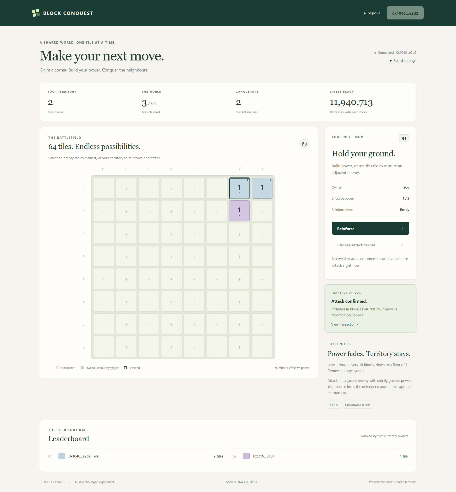
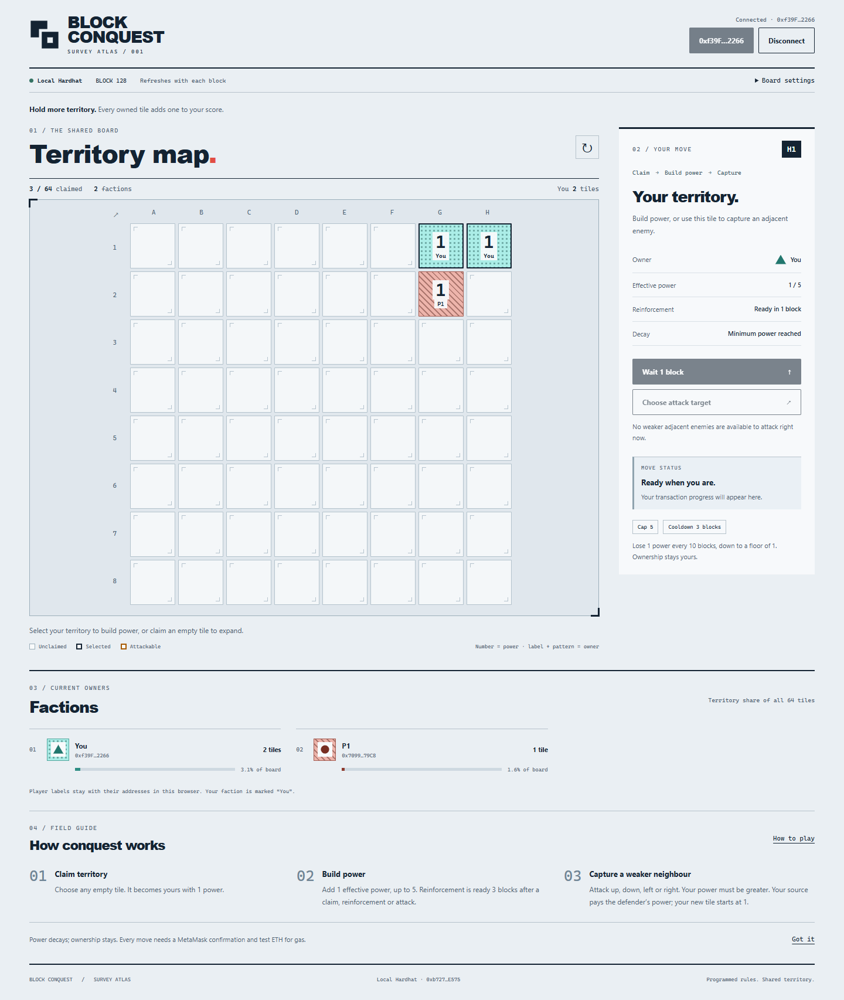
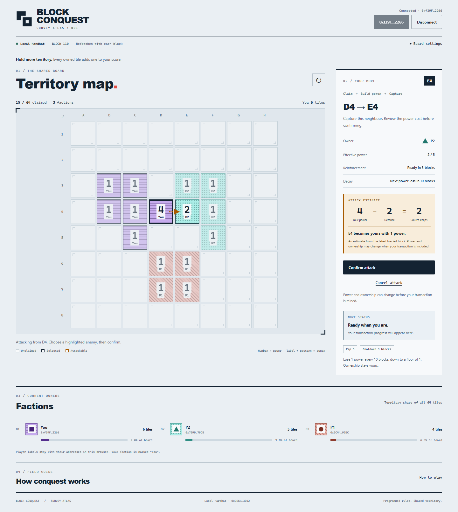

# Block Conquest

A university DApp where players share an 8×8 board on Ethereum Sepolia. Claim empty tiles, reinforce your territory, and capture adjacent enemy tiles. Every move is enforced by a Solidity smart contract and signed through MetaMask.

## Deployed contract

| Item | Value |
| --- | --- |
| Network | Ethereum Sepolia |
| Chain ID | `11155111` |
| Contract | [`0x4D8ebB57f5140fD302F7b1f4Ff57EF23ff1c3Cb3`](https://sepolia.etherscan.io/address/0x4D8ebB57f5140fD302F7b1f4Ff57EF23ff1c3Cb3) |
| Creation transaction | [`0xca33b7db…ca505d81`](https://sepolia.etherscan.io/tx/0xca33b7db66a7fa2db1460285581d2cc879d2e03b4d9626d2ea2fae11ca505d81) |
| Decay interval | `10` blocks |
| Reinforcement cooldown | `3` blocks |
| Maximum power | `5` |

The creation receipt and current values returned by `decayInterval()`, `reinforcementCooldown()`, and `maxPower()` were checked through Sepolia RPC. The deployed runtime matches the compiled contract after excluding compiler metadata and masking immutable-value locations. Details are recorded in [deployment evidence](docs/DEPLOYMENT.md).

## Features and technology

- One shared board per contract in a Survey Atlas interface: faction patterns, colours, player labels, and effective power on every owned tile.
- Claim, reinforce, and capture transactions through MetaMask, with confirmation, pending, success, and error feedback.
- On-chain ownership scores and a frontend leaderboard with territory-share bars counted from `getGrid()` owners.
- Attack outcome previews, per-tile block countdowns, dismissible instructions, and confirmed-capture feedback that respects reduced motion.
- Visible wallet disconnect, an integrated Move panel, and mobile actions that stay within reach.
- Block-based power decay, reinforcement cooldown, and an immutable power cap.
- Refresh on new blocks, account/network change handling, and responsive desktop/mobile layouts.
- No tokens, NFTs, betting, randomness, administrative takeover, or upgrades.

Built with Solidity **0.8.28**, Hardhat **3.19.0**, ethers.js **6.17.0**, Vite **8.3.4**, HTML/CSS/JavaScript, MetaMask, and Sepolia. Mocha tests cover the contract; Node tests cover frontend logic; Playwright covers browser interactions with real local contracts.

## Run locally

Requirements: Git, npm, a supported even-numbered Node.js release (**Node.js 24 LTS recommended**; Hardhat requires at least 22.13.0), and the [MetaMask browser extension](https://metamask.io/). The first compilation downloads the Solidity compiler and needs internet access.

```sh
git clone https://github.com/JishnuJMR/block-conquest.git
cd block-conquest
npm ci
npm test
npm run dev
```

1. Open **http://127.0.0.1:5173** in the browser containing MetaMask.
2. In MetaMask, enable test networks and choose **Ethereum Sepolia**. Submitting moves needs Sepolia test ETH, available from a faucet such as [Google Cloud's Sepolia faucet](https://cloud.google.com/application/web3/faucet/ethereum/sepolia).
3. Open **Board settings**, select **Ethereum Sepolia**, paste `0x4D8ebB57f5140fD302F7b1f4Ff57EF23ff1c3Cb3`, and click **Load board**.
4. Click **Connect wallet** and approve access. The board loads from the deployed contract.

Board settings are saved in the browser. To set public defaults instead, copy `frontend/.env.example` to `frontend/.env.local` with your editor/file manager and restart Vite. Browser-saved settings override these defaults. Never put wallet keys, seed phrases, passwords, or private RPC credentials in frontend variables: `VITE_` values are public.

If port 5173 is in use, stop the other server or run `npm run dev -- --port 5174` and open **http://127.0.0.1:5174**.

**Windows PowerShell note:** if script policy blocks `npm.ps1`, use `npm.cmd` instead of `npm`, for example `npm.cmd ci`. No execution-policy change is required.

## How to play

1. **Claim:** select an empty tile, click **Claim tile**, and confirm in MetaMask. You own it at power 1.
2. **Reinforce:** select your tile, wait for cooldown to finish, click **Reinforce**, and confirm. One point is added to effective power, up to the cap.
3. **Attack:** select your source tile → **Choose attack target** → select a highlighted enemy → **Confirm attack** → approve in MetaMask.

Attacks are allowed only directly above, below, left, or right. Your effective power must be **strictly greater** than the defender's. Capture subtracts the defender's effective power from your source; the captured tile becomes yours at power 1. Scores count currently owned tiles.

Power decays by 1 every 10 blocks since the tile's last update, with a floor of 1. Ownership never decays. Claims, reinforcements, and attacks restart reinforcement cooldown; attacks update both source and captured tiles. Attacks have no separate cooldown. `getTile()` returns stored state, while `effectivePower()` and `getGrid()` include decay. See [rule examples](docs/GAME_RULES.md).

The UI uses A–H and 1–8; A1 is `(0,0)` and H1 is `(7,0)`. Arrow keys move focus between tiles; Enter/Space selects a tile.

Player markers (`P1`, `P2`, …) and six distinct patterns identify factions beyond colour. Your connected faction reads **You** on the board, Move panel, and leaderboard. Underlying labels are saved per board in this browser and stay stable as ranks change; another browser may assign different labels. Addresses identify the actual players. **How to play** reopens the instructions. Select a tile to see reinforcement readiness and the next power-loss countdown, measured in blocks. Power 1 is the minimum. The displayed cap, cooldown and decay interval come from the contract.

Use **Disconnect** beside the wallet address to clear the app session and request removal of MetaMask's account permission. If the wallet cannot remove that permission, the app explains how to finish through MetaMask's Dapp connections. Disconnecting does not remove your territory or cancel an already submitted transaction. The app stays disconnected until **Connect wallet** is clicked again. Live territory requires a connected wallet; the disconnected board is explicitly marked unloaded.

Arrow keys move between tiles, Enter/Space selects, and Escape cancels attack selection or clears the selected tile. On small screens, the action row stays at the bottom of the viewport and includes the selected coordinate, attack estimate, and transaction feedback.

Selecting an attack target previews **your power − defence = power kept by the source**, with the captured tile starting at 1. This uses the latest loaded block; the contract determines the outcome when the transaction is included.

## Deploy your own contract with Remix

The existing Sepolia board can be used without redeployment. To create a separate board:

1. Open [Remix](https://remix.ethereum.org/) in the browser containing MetaMask. Create `contracts/BlockConquest.sol` and paste the complete current [contract source](contracts/BlockConquest.sol) from this repository.
2. In **Solidity Compiler**, select **0.8.28**, enable the optimizer with **200 runs**, and set the EVM target to **cancun**. Compile.
3. In MetaMask, enable test networks, select **Sepolia**, and choose an account funded with Sepolia test ETH.
4. In **Deploy & Run Transactions**, choose **Browser Extension → MetaMask** (also called **Injected Provider – MetaMask**). Approve the connection and check **Sepolia / 11155111**.
5. Select **BlockConquest**, keep **Value = 0**, and enter constructor arguments in order: `decayInterval = 10`, `reinforcementCooldown = 3`, `maxPower = 5`. These values are immutable; intervals must be positive and cap at least 2.
6. Click **Deploy**, review the network and fee, and confirm in MetaMask. Explorer source verification is optional and is not required to deploy or use this app.
7. Save the new contract address and creation transaction hash. Read `decayInterval()`, `reinforcementCooldown()`, and `maxPower()` in Remix to confirm `10`, `3`, and `5`.
8. Enter the new address in the frontend's **Board settings**. This is a separate, initially empty board.

Signing stays in MetaMask. No private-key export, Infura API key, or paid ETH is required. See [Remix deployment documentation](https://remix-ide.readthedocs.io/en/latest/run.html).

For local development, `npm run node:local` starts Hardhat; in another terminal, `npm run deploy:local` prints a local address. Select **Local Hardhat** in Board settings. `npm run deploy:rehearsal` targets an ephemeral local chain only. More instructions are in the [frontend guide](docs/FRONTEND.md).

## Tests and production build

```sh
npm test
npm run typecheck
npm run test:frontend
npm run test:ui
npm run build
```

The suite contains **91 tests**: 62 contract tests, 8 frontend logic tests, and 21 browser integration tests. Run `npm test` before typechecking to generate contract types. Browser tests build the app and start a local node and preview server; ports **8545** and **4173** must be free. They use installed Chrome and a test-only EIP-1193 adapter forwarding to unlocked local Hardhat accounts. They do not automate MetaMask or send public-network transactions.

Install Google Chrome for browser tests, or set `PLAYWRIGHT_CHANNEL` to `msedge` if Microsoft Edge is installed. Contract and frontend logic tests do not need a browser.

Survey Atlas passed a fresh-clone check on Windows: clean installation, all 91 tests, typechecking, production build, and development-server startup. Loading the Sepolia board, disconnecting, and reconnecting were also confirmed through real MetaMask. See [validation details](docs/VALIDATION.md) for the checked snapshot. Earlier Sepolia evidence is retained with its original UI screenshots; the Survey Atlas images below are labelled as local tests.

Coverage includes invalid coordinates/ownership, occupied claims, edges and adjacency, attack power/cost, score updates, caps, exact cooldown/decay boundaries, long inactivity, both effective powers in combat, wallet rejection, stale confirmations, account/network changes, and responsive layout.

`npm run build` emits static files to `frontend/dist/`; `npm run preview` serves them at **http://127.0.0.1:4173**. Public website hosting is not required to run the DApp locally.

## Screenshots and live transactions

Sepolia board in the submission-version UI after a two-account capture: account A owns H1 and G1 (blue), while account B retains G2 (purple). Scores are A: 2 and B: 1. The receipt and contract state at the attack block were independently checked.



- [Successful H1 → G1 capture](https://sepolia.etherscan.io/tx/0xf868656f729c9704f55e5cdaa958dc707028629772a7a3723a0917469f0ecb47)
- [Successful H1 claim](https://sepolia.etherscan.io/tx/0x9fcbd74381c90cf660a619e1a2973635458608b1b6ff62d518cd34f552802ddd)
- [Successful H1 reinforcement to power 2](https://sepolia.etherscan.io/tx/0xaf99d3aa6b37990fee418dbef511ff39a5e450a6f55658a73ba413a87d3de50c)
- [Earlier Sepolia screenshot after reinforcement and decay back to power 1](docs/screenshots/sepolia-board.png)

Survey Atlas with only three tiles claimed on local Hardhat:



Three players and an attack estimate:



[Mobile action row at 360×640](docs/screenshots/atlas-mobile-viewport.png) · [Full mobile view](docs/screenshots/atlas-sparse-mobile.png) · [Six factions in greyscale](docs/screenshots/atlas-six-factions-greyscale.png) · [Greyscale mobile view](docs/screenshots/atlas-six-factions-mobile-greyscale.png). These are local test images, distinct from the Sepolia screenshot above.

## Known limitations

- The contract enforces programmed rules; it is **not cheat-proof**. Transactions are public, and competing claims or attacks can be reordered or front-run.
- Power, ownership, and gas estimates can change between preview and inclusion. Another move or a decay boundary can make a transaction fail.
- One person can control multiple accounts; there is no identity or anti-Sybil mechanism. There are no administrative recovery or upgrade mechanisms.
